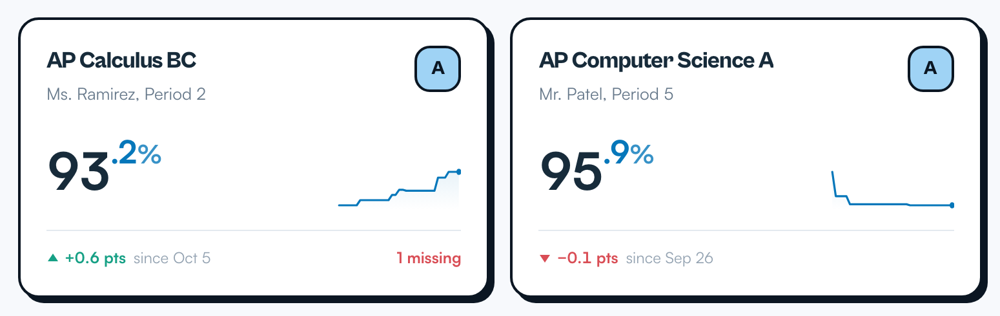
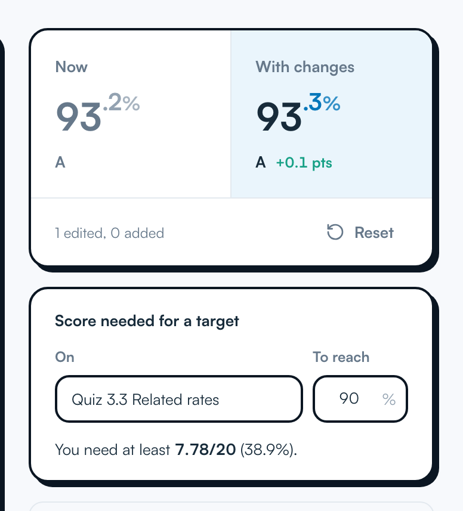
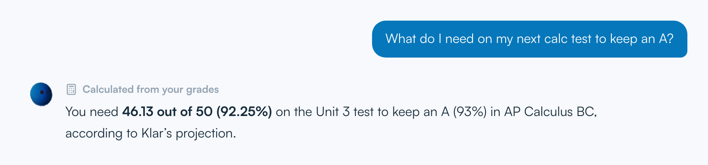
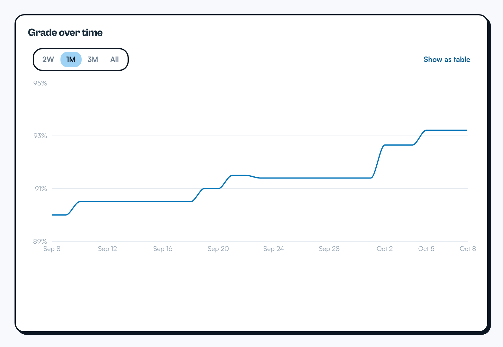

<div align="center">

<a href="https://useklar.vercel.app">
  <picture>
    <source media="(prefers-color-scheme: dark)" srcset="brand/logo-dark.svg">
    
  </picture>
</a>

### Your grades. Finally, clear.

Klar turns your Schoology gradebook into one calm dashboard: exact grades, your GPA, what-if scores, grade history, and an AI assistant that answers questions about your own grades.

[**Open Klar**](https://useklar.vercel.app) · [Privacy Policy](https://useklar.vercel.app/privacy) · [How it works](#how-it-works) · [Run it locally](#run-it-locally)


</div>

---

<table>
  <tr>
    <td width="50%" valign="top">
      <picture>
        <source media="(prefers-color-scheme: dark)" srcset="apps/web/public/screenshots/courses-dark.png">
        
      </picture>
      <p><b>Every class</b><br>Exact grades and categories, side by side.</p>
    </td>
    <td width="50%" valign="top">
      <picture>
        <source media="(prefers-color-scheme: dark)" srcset="apps/web/public/screenshots/whatif-dark.png">
        
      </picture>
      <p><b>What-if</b><br>Try a score and see your grade move. Find the exact score you need.</p>
    </td>
  </tr>
  <tr>
    <td width="50%" valign="top">
      <picture>
        <source media="(prefers-color-scheme: dark)" srcset="apps/web/public/screenshots/ask-dark.png">
        
      </picture>
      <p><b>Ask Klar</b><br>Ask anything about your grades. Math comes from Klar's grade engine, not guesswork.</p>
    </td>
    <td width="50%" valign="top">
      <picture>
        <source media="(prefers-color-scheme: dark)" srcset="apps/web/public/screenshots/history-dark.png">
        
      </picture>
      <p><b>History</b><br>Every change, from your first sync.</p>
    </td>
  </tr>
</table>

## Features

- **Every class on one screen** with the grade Schoology shows, category breakdowns and a trend line
- **Unweighted GPA** on a 4.0 scale
- **What-if calculator**: edit scores, add future assignments, and solve for the score you need
- **Grade history** that starts at your first sync
- **Assignments**: what's due, what's missing (only when your teacher marks it), and a calendar
- **Ask Klar**, an AI assistant with read-only access to your own grades and exact grade-engine tools
- **Light and dark mode**, starting from your system setting

## How it works

1. **Create a Klar account.** An email and a Klar-only password.
2. **Add the Chrome extension.** Klar is being added to the Chrome Web Store; until then, [download it from Releases](https://github.com/aarav-puri/klar/releases/latest) ([VirusTotal: 0/65](https://www.virustotal.com/gui/file/1259f083cc7a9f8fcec519f2463a27a0682cd1b6d021c2a8384da505ff32535d)) and load it unpacked. You sign in to Schoology on Schoology's own page, as usual.
3. **Press Sync.** The extension reads your gradebook and sends it to your Klar account.

Klar never asks for your Schoology password, never reads your cookies, and can't change anything in Schoology. Every student's data is isolated by Postgres row-level security. Details: [docs/SECURITY.md](docs/SECURITY.md).

> Klar is independent and is not affiliated with, endorsed by, or sponsored by Schoology or PowerSchool.

## Built with

| Layer | Technology |
| --- | --- |
| Web app | Next.js 16 (App Router), React 19, TypeScript, Tailwind CSS v4 |
| Database | Neon Postgres with per-student row-level security |
| Accounts | Neon Auth (managed Better Auth): email and password, password reset |
| AI | Vercel AI SDK through Vercel AI Gateway (`openai/gpt-6-luna`) |
| Extension | Chrome Manifest V3, Vite, a strict message protocol shared with the app |
| Shared logic | `packages/core`: grade engine, what-if solver, sync schema, Schoology parsers |
| Tests | Vitest (unit, plus the real migration in PGlite) and Playwright (the real extension end to end) |
| Hosting | Vercel |

## Repository layout

```
apps/web         Next.js app: landing page, sign-in, onboarding, dashboard, API
                 db/migrations: Postgres schema with row-level security (run on Neon)
apps/extension   Chrome MV3 extension that reads the student's own gradebook, with consent
packages/core    Framework-free logic: grade engine, what-if solver, sync schema,
                 Schoology page parser, official API mapper, extension protocol
brand/           Logo and icon SVG sources plus the PNG build script
e2e/             Playwright tests: the real extension in Chromium, a fake Schoology, a Neon test branch
e2e-shots/       The script that captures the product screenshots
docs/            Integration research, security model, brand notes
```

## Run it locally

Requires Node 22+ and the Neon CLI (`npm i -g neon@latest`).

```bash
npm install
neon login
neon link --project-id <your-project-id> --branch production -y
npm run env:pull                     # writes the Neon variables into apps/web/.env.local
npm run db:migrate -w web            # applies db/migrations over the direct (unpooled) connection
```

Add the secrets Neon doesn't provide to `apps/web/.env.local`, then start the app:

```bash
echo "NEON_AUTH_COOKIE_SECRET=$(openssl rand -base64 36)" >> apps/web/.env.local
echo "NEXT_PUBLIC_APP_URL=http://localhost:3000" >> apps/web/.env.local
echo "AI_GATEWAY_API_KEY=..." >> apps/web/.env.local   # optional: turns on Ask Klar
npm run dev                                            # http://localhost:3000
```

`npm run env:pull` only rewrites the Neon variables, so these are kept. Every option is listed in [`apps/web/.env.example`](apps/web/.env.example), including the optional official Schoology API (`SCHOOLOGY_CONSUMER_KEY`, `SCHOOLOGY_CONSUMER_SECRET`, `TOKEN_ENCRYPTION_KEY`).

**Extension:**

```bash
npm run build:extension                                                  # for http://localhost:3000
KLAR_APP_ORIGINS="https://useklar.vercel.app" npm run build:extension   # for production
```

In Chrome: `chrome://extensions`, turn on **Developer mode**, **Load unpacked**, choose `apps/extension/dist`.

## Testing

```bash
npm test                 # core, extension and web unit tests
npm run typecheck
npm run test:e2e         # builds the extension, starts Klar against the e2e Neon branch, runs the end-to-end suite
npm run screenshots      # recaptures the product screenshots (fictional example data)
```

- **Unit tests** cover grade math, the what-if solver, protocol and origin validation, payload sanitization, the page parser and API mapper, OAuth signing, token sealing, rate limiting, workload rules, Ask Klar's context and tools, and the real migration in an in-memory Postgres (row-level security, ingest, account bootstrap and deletion).
- **End-to-end tests** load the built extension into Chromium with a local HTTPS stand-in for Schoology and a fake Schoology API, against a **dedicated Neon branch** (`e2e`, never production): sign-up, connecting, syncing a newly posted score, course details, sign-out, the official-API connection (approved and denied), and forgot password.

Set up the e2e branch once:

```bash
neon branches create --name e2e --parent production
neon env pull --branch e2e --file apps/web/.env.e2e
npx playwright install chromium
```

The suite starts its own dev server on port 3000, so stop any other server on that port first.

## Deploying

Pushes to `main` deploy to production on Vercel (project root: `apps/web`). Preview deployments are created for other branches and pull requests.

- **Env on Vercel:** `DATABASE_URL`, `DATABASE_URL_UNPOOLED`, `NEON_AUTH_BASE_URL`, `NEON_AUTH_JWKS_URL`, `NEON_AUTH_COOKIE_SECRET`, `NEXT_PUBLIC_APP_URL`, and `AI_GATEWAY_API_KEY` for Ask Klar.
- **Trusted domain:** Neon Auth only redirects to allowed origins: `neon neon-auth domain add https://your-domain`.
- **Migrations:** run `npm run db:migrate -w web` with `DATABASE_URL_UNPOOLED` when the schema changes.
- **Email:** configure custom SMTP for Neon Auth before a wide launch (`neon neon-auth config email-provider`); the shared sender is for getting started.
- **Rate limits** are in memory per instance; use a shared store such as Upstash Redis when running several instances.

## Verifying against a real school

The Schoology integration was built to Schoology's current page markup and documented API and tested against faithful fakes. If numbers ever differ from Schoology's, save the gradebook page (names removed) under `packages/core/test/fixtures/` and extend the parser tests. Unrecognized pages produce a clear `PARSE_FAILED` error, never guessed numbers.
